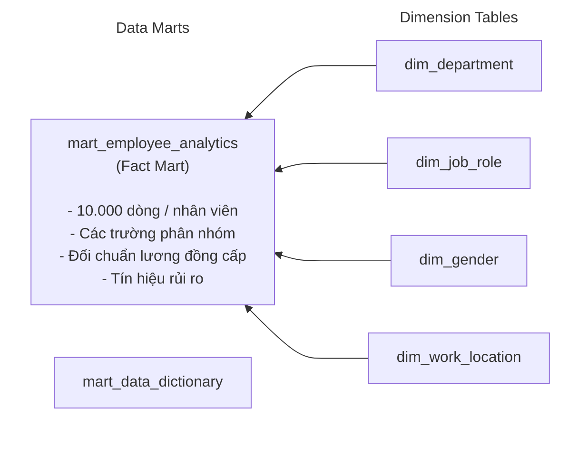

# Phân tích tình trạng nhân viên nghỉ việc tại Công ty Tài chính An Việt

[English](README_en.md) | **Tiếng Việt**

---

## 1. Bối cảnh kinh doanh

Một nhân viên có thể mất nhiều tháng để làm quen với công việc, tích lũy kinh nghiệm và phối hợp hiệu quả với đồng nghiệp. Nhưng khi họ rời đi, người thay thế sẽ cần thời gian để thích nghi với môi trường mới, trong khi những kinh nghiệm mà người cũ tích lũy được cũng khó có thể chuyển giao đầy đủ trong thời gian ngắn cho người mới. Khi tình trạng này diễn ra ở nhiều nhân viên trong cùng một giai đoạn, doanh nghiệp cần nhìn nhận nghiêm túc hơn về tình hình nhân sự và tìm hiểu những vấn đề có thể đang tồn tại bên trong tổ chức.

Tại An Việt, những biến động nhân sự gần đây cũng khiến Ban Giám đốc quan tâm hơn đến vấn đề này. Trong một buổi trao đổi với bộ phận People Analytics, Giám đốc Nhân sự (Head of People) đặt ra yêu cầu:

> **Dạo gần đây tỷ lệ nhân viên nghỉ việc của công ty tăng khá bất thường khiến một số dự án bị ảnh hưởng tiến độ và công ty cũng phải tốn thêm nhiều chi phí để tuyển dụng, đào tạo người thay thế. Anh muốn nhìn lại tình hình này một cách rõ ràng hơn, nên em giúp anh xây dựng một dashboard để theo dõi thực trạng nghỉ việc và xem vấn đề đang tập trung ở đâu, từ đó anh có cơ sở để xác định những việc cần ưu tiên xử lý nhé.**

Từ yêu cầu của Giám đốc Nhân sự, tôi chia thành các mục tiêu sau:

1. Đánh giá quy mô và tỷ lệ nhân viên nghỉ việc theo phòng ban, vị trí công việc và thâm niên
2. Xác định các yếu tố liên quan đến quyết định nghỉ việc (giờ làm, làm thêm giờ, mức độ hài lòng, phản hồi của quản lý)
3. Rà soát tính công bằng trong chính sách đãi ngộ giữa các nhóm đồng cấp và theo giới tính
4. Nhận diện nhóm nhân sự hiệu suất cao có rủi ro rời bỏ để kịp thời đưa ra giải pháp giữ chân

---

## 2. Đầu ra kỳ vọng

Để đáp ứng yêu cầu của Giám đốc Nhân sự, báo cáo được thiết kế thành hệ thống gồm 4 Dashboard liên kết theo luồng phân tích từ nhận diện thực trạng đến giải pháp khuyến nghị:

| STT | Dashboard | Nội dung trình bày | Ý nghĩa |
| :---: | :--- | :--- | :--- |
| **01** | **Tổng quan tình trạng nghỉ việc** | Trực quan hóa bức tranh tổng thể về quy mô, tỷ lệ nghỉ việc toàn công ty và tỷ lệ nghỉ việc giữa các nhóm nhân sự | Xác định tình trạng nghỉ việc đang tập trung ở đâu và nhóm nào cần được tìm hiểu sâu hơn |
| **02** | **Yếu tố liên quan đến nghỉ việc** | Phân tích mối liên hệ giữa tình trạng nghỉ việc với các đặc trưng liên quan tới nhân sự và các khía cạnh trong công việc | Nhận diện những yếu tố đáng chú ý có thể ảnh hưởng đến quyết định nghỉ việc của nhân viên |
| **03** | **Tính công bằng trong thu nhập** | Đánh giá chênh lệch thu nhập giữa các nhóm nhân sự khác nhau | Nhận diện những vấn đề tiềm ẩn trong thu nhập để xem xét lại tính công bằng của chính sách đãi ngộ |
| **04** | **Rủi ro mất nhân sự chủ chốt** | Nhận diện rủi ro rời bỏ ở nhóm nhân sự có hiệu suất cao (`performance_rating >= 4`) | Xác định những nhóm có tình trạng mất nhân sự hiệu suất cao cần được chú ý để ưu tiên tìm hiểu và cân nhắc biện pháp giữ chân phù hợp |

---

## 3. Dữ liệu

### 3.1. Quy mô dữ liệu

| Chỉ tiêu | Kết quả kiểm tra |
|---|---:|
| Tổng số nhân viên ghi nhận | 10.000 |
| Số nhân viên đã nghỉ việc (`churn = True`) | 2.028 |
| Tỷ lệ nghỉ việc toàn công ty | 20,28% |
| Mốc thời gian tham chiếu phân tích | Năm 2026 |

### 3.2. Các đặc trưng chính

| Tên cột | Kiểu dữ liệu | Mô tả |
|---|---|---|
| `employee_id` | String | Mã định danh duy nhất của nhân viên |
| `age` | Integer | Tuổi của nhân viên |
| `gender` | String | Giới tính ghi nhận (`Male`, `Female`, `Other`) |
| `education_level` | String | Trình độ học vấn cao nhất |
| `marital_status` | String | Tình trạng hôn nhân (`Single`, `Married`, `Divorced`) |
| `tenure` | Integer | Thâm niên công tác (giả định đơn vị là năm) |
| `job_role` | String | Vị trí công việc (`Analyst`, `Developer`, `Manager`, `Sales`) |
| `department` | String | Phòng ban (`IT`, `Sales`, `Marketing`, `HR`) |
| `salary` | Decimal | Mức lương ghi nhận |
| `work_location` | String | Hình thức làm việc (`Remote`, `Hybrid`, `On-site`) |
| `performance_rating` | Decimal | Điểm đánh giá hiệu suất (thang điểm từ 1 đến 5) |
| `projects_completed` | Integer | Số dự án đã hoàn thành |
| `training_hours` | Integer | Số giờ tham gia đào tạo |
| `promotions` | Integer | Cờ chỉ báo nhị phân nhân viên từng được thăng chức (0/1) |
| `overtime_hours` | Integer | Số giờ làm thêm được ghi nhận |
| `satisfaction_level` | Decimal | Mức độ hài lòng của nhân viên (thang điểm từ 0 đến 1) |
| `work_life_balance` | Null | Chỉ số cân bằng công việc và cuộc sống |
| `average_monthly_hours_worked` | Integer | Số giờ làm việc trung bình mỗi tháng |
| `absenteeism` | Integer | Số ngày vắng mặt được ghi nhận | Tín hiệu về mức độ gắn kết / kiệt sức |
| `distance_from_home` | Decimal | Khoảng cách từ nhà đến nơi làm việc |
| `manager_feedback_score` | Decimal | Điểm phản hồi từ cấp quản lý (thang điểm từ 1 đến 10) |
| `churn` | Boolean | Trạng thái nghỉ việc (`True`: đã nghỉ việc, `False`: còn làm việc) |

---

## 4. Quy trình thực hiện

Dự án được triển khai theo quy trình phân tích dữ liệu gồm 5 giai đoạn: 

Khảo sát nghiệp vụ → Tìm nguồn dữ liệu phù hợp & nhập dữ liệu vào cơ sở dữ liệu → Tiền xử lý dữ liệu → Tạo các bảng dim và mart để phục vụ cho trực quan hóa dữ liệu → Xây dựng Dashboard Power BI → Đề xuất khuyến nghị hành động.

### 4.1. Tiền xử lý dữ liệu

- **Nhập liệu vào hệ quản trị cơ sở dữ liệu**: Sử dụng DBeaver để tải tệp `employee_info.xlsx` vào cơ sở dữ liệu PostgreSQL.
- **Sử dụng PLSQL Programming để khám phá dữ liệu ([data_quality_check.sql](data_quality_check.sql))**:
  - *Kiểm tra trùng lặp*: Xác nhận đủ 10.000 dòng, không có mã `employee_id` trùng lặp.
  - *Kiểm tra giá trị thiếu*: Ngoại trừ trường `work_life_balance` bị thiếu toàn bộ 10.000 giá trị (100% Null), tất cả 21 trường còn lại đều đầy đủ giá trị hợp lệ. Quyết định loại bỏ `work_life_balance` khỏi toàn bộ quy trình phân tích.
  - *Kiểm tra miền giá trị hợp lệ*: Xác nhận tuổi nằm trong khoảng từ 18 đến 65 tuổi; thâm niên công tác từ 0 đến 10 năm; mức lương đều lớn hơn 0; điểm đánh giá hiệu suất nằm trong thang điểm từ 1 đến 5; mức độ hài lòng từ 0 đến 1; và điểm phản hồi của quản lý từ 1 đến 10.

### 4.2. Xây dựng mô hình dữ liệu

Sử dụng PLSQL Programming xây dựng các bảng dim và fact ([reporting_marts.sql](reporting_marts.sql))

1. **Xây dựng các bảng Dimension**:
   - `dim_department`: Bảng chiều danh mục phòng ban (`IT`, `Sales`, `Marketing`, `HR`).

   - `dim_job_role`: Bảng chiều danh mục vị trí công việc (`Analyst`, `Developer`, `Manager`, `Sales`).

   - `dim_gender`: Bảng chiều danh mục giới tính (`Male`, `Female`, `Other`).

   - `dim_work_location`: Bảng chiều hình thức làm việc (`Remote`, `Hybrid`, `On-site`).

2. **Xây dựng bảng fact (`mart_employee_analytics`)**:

Trong đó:

- `tenure_band`: Nhóm thâm niên (`Under 1 year`, `1 to under 3 years`, `3 to 5 years`, `Over 5 years`).
- `age_band`: Chia độ tuổi theo các khoảng thống nhất kèm.
- `overtime_band`: Nhóm giờ làm thêm (`0 hours`, `1-10 hours`, `11-20 hours`, `21+ hours`).
- `monthly_hours_band`: Nhóm giờ làm việc mỗi tháng (`150-179`, `180-209`, `210-239`, `240-269`, `270+`).
- `performance_group`: Nhóm hiệu suất công việc (`Low (1-2)`, `Medium (3)`, `High (4-5)`).
- `satisfaction_band` và `feedback_band`: Phân nhóm mức độ hài lòng và điểm đánh giá của quản lý theo các khoảng Thấp, Trung bình, Cao.
- `peer_median_salary`: Mức lương trung vị của nhóm đồng cấp (cùng `job_role` và `tenure_band`).
- `salary_gap_vs_peer_median_pct`: Mức độ chênh lệch phần trăm giữa lương nhân viên và lương trung vị nhóm đồng cấp: `(salary - peer_median_salary) / peer_median_salary`.
- `role_peer_avg_salary`: Mức lương trung bình của những nhân viên khác cùng vai trò (được tính bằng cách loại trừ chính nhân viên đang xét).
- `role_salary_gap_pct`: Chênh lệch phần trăm so với lương trung bình cùng vai trò: `(salary - role_peer_avg_salary) / role_peer_avg_salary`.
- `underpaid_10_flag` & `underpaid_25_flag`: Đánh dấu các trường hợp nhận lương thấp hơn mức tham chiếu từ 10% và từ 25% trở lên.

3. **Từ điển dữ liệu (`mart_data_dictionary`)**:
   Lưu trữ siêu dữ liệu (metadata), tên cột, kiểu dữ liệu, định nghĩa nghiệp vụ và vai trò trong phân tích, phục vụ trực tiếp cho trang tra cứu Data Dictionary trên dashboard Power BI.

---

## 5. Trực quan hóa và phân tích thực trạng trên Power BI

### 5.1. Tổng quan về tình trạng nghỉ việc

Dữ liệu ghi nhận quy mô toàn công ty gồm **10.000 nhân viên**, trong đó **2.028 người đã nghỉ việc**, tương ứng với tỷ lệ churn toàn công ty là **20,28%**.

Trong đó:

- **Tỷ lệ churn giữa các phòng ban dao động rất hẹp**, chỉ từ **20,21% đến 20,75%**. Bộ phận Marketing ghi nhận tỷ lệ cao nhất (20,75%), tiếp theo là HR (20,25%), IT (20,23%) và Sales (20,21%).
- **Phân bố theo năm tuyển dụng**: Nhóm nhân viên có năm bắt đầu làm việc là 2018 ghi nhận tỷ lệ churn cao nhất, đạt **22,69%**, trong khi nhóm năm 2025 thấp nhất (**18,00%**). Chỉ số này được suy ra từ thâm niên và mốc phân tích năm 2026, không phải ngày tuyển dụng thực tế.
- **Phân bố theo thâm niên**: Nhóm nhân viên có thâm niên trên 5 năm ghi nhận tỷ lệ churn là **20,93%**, cao hơn nhóm 1 đến dưới 3 năm (**18,51%**).
- **Nhìn chung**: Hiện tượng nghỉ việc không tập trung cục bộ tại một phòng ban hay nhóm thâm niên riêng lẻ, cho thấy bài toán duy trì nguồn nhân lực cần được tiếp cận ở phạm vi toàn công ty.

**Kết luận**: Tỷ lệ churn tương đối đồng đều giữa các phòng ban và nhóm thâm niên cho thấy tình trạng nghỉ việc mang tính toàn công ty hơn là vấn đề riêng lẻ. Doanh nghiệp nên ưu tiên các chính sách giữ chân nhân sự có tính đồng bộ, đồng thời chú trọng cải thiện trải nghiệm làm việc và cơ hội phát triển nghề nghiệp nhằm hạn chế tỷ lệ nghỉ việc trên toàn tổ chức.

---

### 5.2. Yếu tố có khả năng làm tăng tình trạng nghỉ việc

- **Giới tính**: Nữ ghi nhận tỷ lệ churn **20,99%**, nam **19,91%** và nhóm giới tính khác **12,44%**.
- **Giờ làm thêm (Overtime)**: Nhóm nhân viên không làm thêm giờ ghi nhận tỷ lệ churn **25,00%**, cao hơn nhóm làm thêm trên 20 giờ (**20,22%**).
- **Giờ làm việc và mức độ hài lòng**: Khi số giờ làm việc trung bình mỗi tháng tăng từ nhóm 150–179 giờ lên trên 270 giờ, tỷ lệ churn trong dữ liệu có xu hướng giảm nhẹ từ **21,37% xuống 18,32%**.
- **Đánh giá của quản lý và cơ hội thăng tiến**: Tỷ lệ churn ở cả ba nhóm điểm phản hồi của quản lý (Thấp, Trung bình, Cao) đều xấp xỉ mức 20%; tỷ lệ nhân viên từng được thăng chức cũng chỉ dao động đều đặn từ **9,69% đến 10,44%**.
- **Mức độ vắng mặt (Absenteeism)**: Số ngày vắng mặt trung bình giữa các phòng ban gần như bằng nhau, dao động trong khoảng cực hẹp từ **9,44 đến 9,50 ngày**.

**Kết luận**: Các chỉ số cho thấy tỷ lệ churn nhìn chung ít biến động theo giờ làm việc, phản hồi của quản lý, cơ hội thăng tiến và mức độ vắng mặt. Đáng chú ý, nữ giới và nhóm không làm thêm giờ ghi nhận tỷ lệ nghỉ việc cao hơn các nhóm so sánh; do đó, doanh nghiệp nên chú trọng chính sách giữ chân nhân sự phù hợp với từng nhóm, đồng thời cải thiện trải nghiệm làm việc trên toàn tổ chức.

---

### 5.3. Công bằng thu nhập

- **Phân phối lương**: Mức lương trung bình toàn công ty đạt **$89.773**, trung vị lương đạt **$89.243**. Mức lương trung bình giữa nhóm nhân viên đang làm việc (**$89.761**) và nhóm nhân viên đã nghỉ việc (**$89.821**) gần như tương đương, cho thấy mức lương thấp không phải là yếu tố giải thích trực tiếp cho quyết định nghỉ việc.
- **Độ lệch lương so với đồng cấp**:
  - Có **4.233 nhân viên** đang nhận mức lương thấp hơn trung bình của các đồng nghiệp cùng vai trò từ 10% trở lên.
  - Đáng chú ý, có **3.090 nhân viên** nhận mức lương thấp hơn mức tham chiếu từ 25% trở lên.
- **Tương quan giữa lương và hiệu suất**: Mức lương trung bình không tăng tịnh tiến theo kết quả đánh giá hiệu suất: nhóm hiệu suất thấp đạt mức lương trung bình cao nhất ($89.949), nhóm trung bình thấp nhất ($89.269) và nhóm hiệu suất cao đạt $89.846.
- **Chênh lệch lương theo giới tính**: Mức lương trung bình của nữ thấp hơn nam khoảng **1,19%**. Khi đối chiếu và kiểm soát theo vị trí công việc và nhóm thâm niên, mức chênh lệch thu hẹp xuống còn **-0,55%** (nhóm giới tính khác chênh lệch **-1,40%**).
- **Chênh lệch lương theo bộ phận**: Bộ phận Kinh doanh có mức lương trung bình và trung vị **cao nhất, vượt $90k**, mức lương trung bình của các bộ phận còn lại cũng dao động quanh **$89k**, cho thấy chênh lệch lương giữa các bộ phận nhìn chung không đáng kể.

**Kết luận**: Mặt bằng lương giữa nhân viên đang làm việc và đã nghỉ việc gần như tương đương, đồng thời chênh lệch lương giữa các bộ phận và giới tính tương đối nhỏ sau khi đối chiếu theo vị trí và thâm niên. Tuy nhiên, tình trạng nhiều nhân viên nhận lương thấp hơn đáng kể so với đồng cấp và mức lương chưa phản ánh rõ sự khác biệt về hiệu suất cho thấy doanh nghiệp cần chú trọng hơn đến tính công bằng nội bộ và sự tương xứng giữa đãi ngộ với đóng góp của nhân viên.

---

### 5.4. Rủi ro mất nhân sự chủ chốt

- Chỉ tiêu `performance_rating >= 4` được sử dụng để nhận diện nhóm nhân viên có hiệu suất cao. 
- Dữ liệu thể hiện có **4.092 nhân viên hiệu suất cao**, trong đó có **823 người đã nghỉ việc**, tương ứng tỷ lệ churn trong nhóm này là **20,11%** (xấp xỉ mức trung bình toàn công ty).

Trong đó:

- Xét theo phòng ban:
  * Nhóm hiệu suất cao thuộc phòng ban Marketing có tỷ lệ churn cao nhất so với các phòng ban còn lại là **23,20%**, nhưng quy mô của nhóm này chỉ có 388 người (90 nhân viên đã nghỉ), thấp hơn đáng kể so với áp lực tại khối IT (337/1,645 nhân viên đã nghỉ).
- Xét theo vị trí làm việc:
  * Bộ phận Phân tích ghi nhận tỷ lệ churn cao nhất **(21,58%)**, tương ứng **251/1,163** nhân viên đã nghỉ việc. Đây là số lượng đáng chú ý khi so với vị trí Phát triển hệ thống có số nhân viên nghỉ việc cao nhất **(330 người)**.
- Xét theo vị trí và phòng ban làm việc:
  * Nhóm chuyên viên phân tích - khối IT ghi nhận tỷ lệ churn lên tới **23,83%** (tương ứng 112 trên 470 nhân sự hiệu suất cao rời bỏ). Đây là nhóm có tỷ lệ hao hụt nhân tài cao nhất và cần được ban lãnh đạo ưu tiên tìm hiểu nguyên nhân trực tiếp.
  * Nhóm lập trình viên phát triển hệ thống - khối IT ghi nhận **126 nhân sự hiệu suất cao đã nghỉ việc** (trên tổng số 658 người). Đây là nhóm có số lượng nhân tài rời bỏ lớn nhất trong toàn bộ các tổ hợp phòng ban – vị trí công việc.

- Xét về số lượng, khối IT có số lượng nhân sự hiệu suất cao nghỉ việc đông nhất toàn công ty, lên tới **337 người** trên tổng số 1.645 nhân sự hiệu suất cao (chiếm hơn 40% tổng số nhân tài rời bỏ).
- Về thâm niên làm việc, nhóm nhân sự hiệu suất cao có thâm niên trên 5 năm ghi nhận tỷ lệ churn là **20,87%**. 
- Về hình thức làm việc, sự khác biệt về tỷ lệ nghỉ việc giữa các hình thức làm việc (Remote, Hybrid, On-site) là không đáng kể, chỉ dao động từ **19,81% đến 20,89%**.

**Kết luận**: Tỷ lệ churn của nhóm nhân viên hiệu suất cao đạt 20,11%, xấp xỉ mức trung bình toàn công ty, nhưng tình trạng hao hụt nhân tài tập trung đáng chú ý tại **khối IT**. Trong đó, chuyên viên **Phân tích thuộc IT** có tỷ lệ nghỉ việc cao nhất (23,83%), còn nhóm **Lập trình viên phát triển hệ thống thuộc IT** có số nhân sự hiệu suất cao nghỉ việc lớn nhất (126 người). Doanh nghiệp nên ưu tiên giữ chân nhân sự chủ chốt tại **khối IT**, đặc biệt ở hai nhóm này, thông qua các chính sách đãi ngộ, phát triển nghề nghiệp và ghi nhận đóng góp phù hợp.

---

## 6. Khuyến nghị quản trị nhân sự

**1. Cải thiện trải nghiệm làm việc và chính sách giữ chân nhân sự**

- Xây dựng môi trường làm việc công bằng, minh bạch, tạo điều kiện phát triển năng lực và ghi nhận đóng góp của nhân viên.
- Quan tâm đến sự khác biệt về trải nghiệm giữa các nhóm nhân viên, đặc biệt là nhóm nữ và nhóm không ghi nhận giờ làm thêm.
- Duy trì các chính sách giữ chân nhân sự trên toàn công ty, đồng thời ưu tiên nguồn lực cho những nhóm vừa có tỷ lệ churn cao vừa có số lượng nhân sự nghỉ việc lớn.

**2. Tăng cường tính công bằng trong chính sách lương thưởng**

- Rà soát các trường hợp có mức lương thấp hơn đáng kể so với mức tham chiếu của nhân viên cùng vai trò, đặc biệt là nhóm thấp hơn từ 25% trở lên.
- Xây dựng khung lương dựa trên vai trò, thâm niên, năng lực và mức độ đóng góp; bảo đảm việc đánh giá và điều chỉnh lương được thực hiện nhất quán.
- Kết hợp kết quả đánh giá hiệu suất với chính sách thưởng và ghi nhận đóng góp, nhằm tăng tính minh bạch và tương xứng giữa đãi ngộ với hiệu quả công việc.

**3. Ưu tiên giữ chân nhân sự hiệu suất cao tại khối IT**

- Xem xét các chính sách đãi ngộ, lộ trình phát triển nghề nghiệp và cơ hội thăng tiến phù hợp cho chuyên viên Phân tích và Lập trình viên phát triển hệ thống thuộc IT.
- Tăng cường ghi nhận thành tích, tạo cơ hội tham gia các dự án có giá trị và xây dựng lộ trình phát triển chuyên môn rõ ràng cho nhân sự chủ chốt.
- Triển khai các chính sách giữ chân nhân tài theo hướng linh hoạt, phù hợp với đặc điểm công việc và nhu cầu nhân sự.

---

## 7. Giá trị cá nhân đạt được sau dự án

Nắm tư duy và quy trình triển khai một bài toán phân tích dữ liệu nhân viên thực tế từ đầu đến cuối:

- Hiểu thêm về nghiệp vụ trong lĩnh vực quản trị nhân sự như tình trạng nghỉ việc, công bằng thu nhập và giữ chân nhân tài; cũng như cách tiếp cận các bài toán quản trị nhân sự dựa trên dữ liệu
- Sử dụng PostgreSQL để kiểm tra chất lượng dữ liệu, phát hiện và xử lý các vấn đề về tính toàn vẹn, khuyết thiếu và dữ liệu bất thường. Thiết kế các bảng Dimension và Fact/Mart phục vụ phân tích, xây dựng các chỉ số dẫn xuất và logic đối sánh thu nhập giữa các nhóm nhân sự tương đồng.
- Kết nối và mô hình hóa dữ liệu trên Power BI, xây dựng DAX measures và thiết kế các dashboard theo từng mục tiêu phân tích. Trực quan hóa các chỉ số, xu hướng và nhóm rủi ro trọng yếu nhằm giúp nhanh chóng nắm bắt thực trạng và xác định các vấn đề cần ưu tiên xử lý.
