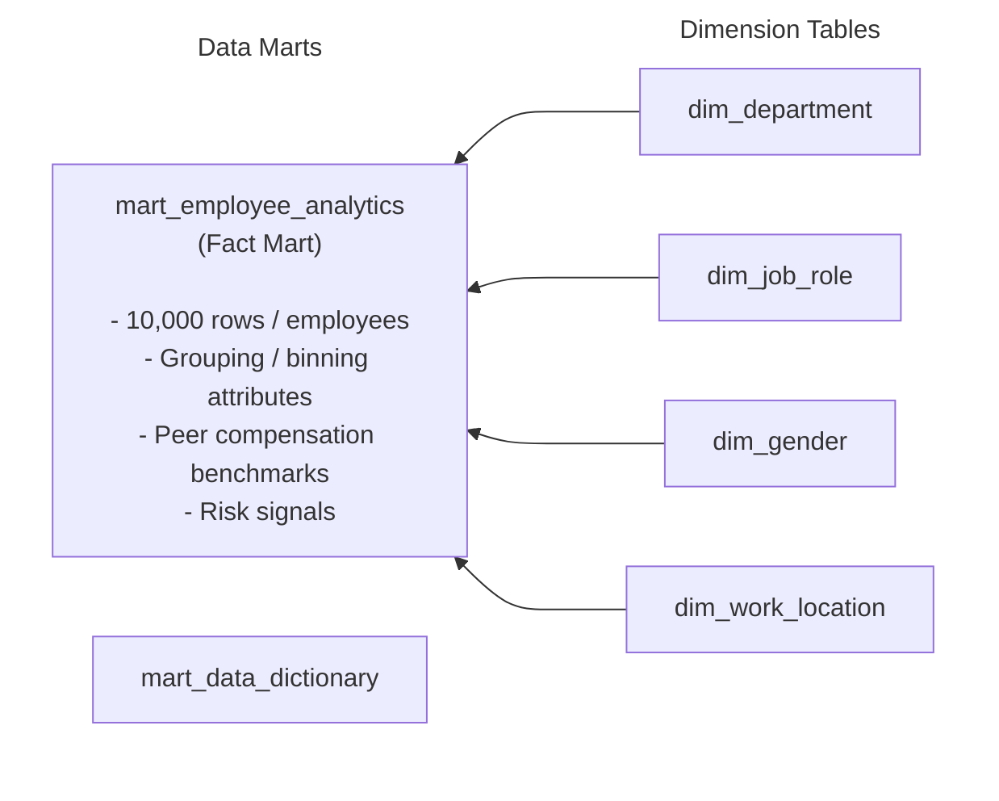

# Employee Churn Analysis at An Viet Financial Company

**English** | [Tiếng Việt](README.md)

---

## 1. Business Context

An employee may take several months to get acquainted with their work, accumulate experience, and collaborate effectively with colleagues. But when they depart, their replacement requires time to adapt to the new environment, while the expertise built up by the predecessor can hardly be fully transferred in a short period. When this situation occurs across numerous employees within the same period, the organization needs to take a more serious look at its workforce health and explore potential underlying issues within the organization.

At An Viet, recent personnel fluctuations have drawn heightened attention from the Board of Directors. During a discussion with the People Analytics team, the Head of People stated the requirement:

> **"Recently, our employee churn rate has increased quite unusually, causing delays in several projects and costing the company significant additional expenses to recruit and train replacements. I want to look back at this situation more clearly, so please help me build a dashboard to track churn realities and see where the problem is concentrated, providing me with an empirical basis to determine priority actions."**

From the Head of People's request, I divided the problem into the following objectives:

1. Assess the scale and churn rate of employees across departments, job roles, and tenure cohorts.
2. Identify factors associated with churn decisions (working hours, overtime, satisfaction levels, manager feedback).
3. Review compensation equity across peer groups and by gender.
4. Identify high-performing talent at risk of leaving to propose timely retention solutions.

---

## 2. Expected Outcomes

To address the Head of People's requirements, the reporting system is designed as a suite of 4 interconnected Dashboards following an analytical flow from reality diagnosis to recommended actions:

| No. | Dashboard | Content & Scope | Business Significance |
| :---: | :--- | :--- | :--- |
| **01** | **Churn Overview** | Visualizes the overall landscape regarding company-wide churn scale, churn rate, and churn distribution across employee segments | Identifies where churn is concentrated and which employee groups require deeper investigation |
| **02** | **Factors Associated with Churn** | Analyzes the relationships between churn status and employee attributes as well as various work aspects | Pinpoints notable factors that may influence employees' decisions to leave |
| **03** | **Compensation Fairness** | Evaluates salary disparities across different employee groups | Identifies underlying compensation issues to reassess the fairness of remuneration policies |
| **04** | **Key Talent Loss Risk** | Identifies attrition risks among high-performing employees (`performance_rating >= 4`) | Pinpoints segments with high attrition among top talent to prioritize root-cause analysis and determine appropriate retention measures |

---

## 3. Data

### 3.1. Dataset Scale

| Metric | Inspection Result |
|---|---:|
| Total recorded employees | 10,000 |
| Departed employees (`churn = True`) | 2,028 |
| Company-wide churn rate | 20.28% |
| Analysis reference year | 2026 |

### 3.2. Key Features

| Column Name | Data Type | Description |
|---|---|---|
| `employee_id` | String | Unique employee identifier |
| `age` | Integer | Employee age |
| `gender` | String | Recorded gender (`Male`, `Female`, `Other`) |
| `education_level` | String | Highest completed education level |
| `marital_status` | String | Marital status (`Single`, `Married`, `Divorced`) |
| `tenure` | Integer | Length of service (assumed unit: years) |
| `job_role` | String | Job title (`Analyst`, `Developer`, `Manager`, `Sales`) |
| `department` | String | Department (`IT`, `Sales`, `Marketing`, `HR`) |
| `salary` | Decimal | Recorded salary |
| `work_location` | String | Work arrangement (`Remote`, `Hybrid`, `On-site`) |
| `performance_rating` | Decimal | Performance evaluation score (scale 1 to 5) |
| `projects_completed` | Integer | Number of completed projects |
| `training_hours` | Integer | Number of training hours attended |
| `promotions` | Integer | Binary indicator of prior promotion (0/1) |
| `overtime_hours` | Integer | Recorded overtime hours |
| `satisfaction_level` | Decimal | Employee job satisfaction score (scale 0 to 1) |
| `work_life_balance` | Null | Work-life balance index |
| `average_monthly_hours_worked` | Integer | Average monthly working hours |
| `absenteeism` | Integer | Number of recorded absent days |
| `distance_from_home` | Decimal | Distance from home to workplace |
| `manager_feedback_score` | Decimal | Manager feedback rating (scale 1 to 10) |
| `churn` | Boolean | Departure status (`True`: departed, `False`: active) |

---

## 4. Project Workflow

The project was executed through an end-to-end data analytics workflow comprising 5 stages:

Business exploration → Sourcing suitable data & database ingestion → Data preprocessing → Building dimension and mart tables for data visualization → Power BI Dashboard authoring → Formulating business recommendations.

### 4.1. Data Preprocessing

- **Database Ingestion**: Used DBeaver to import the `employee_info.xlsx` file into the PostgreSQL database.
- **Using PL/SQL Programming for exploratory data analysis ([data_quality_check.sql](data_quality_check.sql))**:
  - *Duplicate check*: Verified exactly 10,000 rows with no duplicate `employee_id`.
  - *Missing value check*: Aside from `work_life_balance` having 10,000 missing values (100% Null), all 21 remaining attributes contain complete valid values. Decided to exclude `work_life_balance` from the entire analysis pipeline.
  - *Valid range check*: Verified that age ranges from 18 to 65 years; tenure spans 0 to 10 years; salary values are strictly positive; performance rating spans 1 to 5; satisfaction levels range from 0 to 1; and manager feedback scores range from 1 to 10.

### 4.2. Data Modeling

Built dimension and fact tables using PL/SQL Programming ([reporting_marts.sql](reporting_marts.sql)):

1. **Building Dimension Tables**:
   - `dim_department`: Department dimension table (`IT`, `Sales`, `Marketing`, `HR`).

   - `dim_job_role`: Job role dimension table (`Analyst`, `Developer`, `Manager`, `Sales`).

   - `dim_gender`: Gender dimension table (`Male`, `Female`, `Other`).

   - `dim_work_location`: Work arrangement dimension table (`Remote`, `Hybrid`, `On-site`).

2. **Building Fact Table (`mart_employee_analytics`)**:

Details:

- `tenure_band`: Tenure brackets (`Under 1 year`, `1 to under 3 years`, `3 to 5 years`, `Over 5 years`).
- `age_band`: Age brackets with uniform intervals.
- `overtime_band`: Overtime hours brackets (`0 hours`, `1-10 hours`, `11-20 hours`, `21+ hours`).
- `monthly_hours_band`: Monthly working hours brackets (`150-179`, `180-209`, `210-239`, `240-269`, `270+`).
- `performance_group`: Performance rating groups (`Low (1-2)`, `Medium (3)`, `High (4-5)`).
- `satisfaction_band` and `feedback_band`: Satisfaction and manager feedback tiers categorized into Low, Medium, High.
- `peer_median_salary`: Median salary of peer group (matching `job_role` and `tenure_band`).
- `salary_gap_vs_peer_median_pct`: Percentage salary variance compared to peer median: `(salary - peer_median_salary) / peer_median_salary`.
- `role_peer_avg_salary`: Average salary of peers in the same job role (calculated by excluding the evaluated employee).
- `role_salary_gap_pct`: Percentage variance relative to role peer average: `(salary - role_peer_avg_salary) / role_peer_avg_salary`.
- `underpaid_10_flag` & `underpaid_25_flag`: Flags identifying employees compensated below benchmark by 10% and 25% or more.

3. **Data Dictionary (`mart_data_dictionary`)**:
   Stores metadata, column names, data types, business definitions, and analytical roles, directly powering the Data Dictionary lookup page on the Power BI dashboard.

---

## 5. Visualization and Analysis on Power BI

### 5.1. Churn Overview

The data records a company-wide workforce of **10,000 employees**, with **2,028 departed employees**, corresponding to a company-wide churn rate of **20.28%**.

Key findings:

- **Department churn rates vary within a very tight band**, from **20.21% to 20.75%**. Marketing records the highest rate (20.75%), followed by HR (20.25%), IT (20.23%), and Sales (20.21%).
- **Distribution by hire cohort**: Employees whose starting year was 2018 recorded the highest churn rate at **22.69%**, while the 2025 cohort was the lowest (**18.00%**). This indicator is inferred from tenure and the 2026 analysis baseline, not actual hiring dates.
- **Distribution by tenure**: Employees with over 5 years of tenure recorded a churn rate of **20.93%**, higher than those with 1 to under 3 years (**18.51%**).
- **Overall assessment**: Turnover is not concentrated locally in any single department or tenure bracket, indicating that workforce retention must be approached company-wide.

**Conclusion**: The relatively uniform churn rates across departments and tenure cohorts show that turnover is an organization-wide issue rather than an isolated departmental problem. The company should prioritize synchronized retention policies while focusing on enhancing the workplace experience and career development opportunities to mitigate turnover across the entire organization.

---

### 5.2. Factors Potentially Driving Employee Churn

- **Gender**: Females recorded a churn rate of **20.99%**, males **19.91%**, and the other gender group **12.44%**.
- **Overtime Hours**: Employees with no overtime recorded a churn rate of **25.00%**, higher than those working over 20 overtime hours (**20.22%**).
- **Working Hours and Satisfaction**: As average monthly working hours increase from 150–179 hours to over 270 hours, the churn rate in the data shows a slight downward trend from **21.37% down to 18.32%**.
- **Manager Feedback and Promotion Opportunities**: Churn rates across all three manager feedback groups (Low, Medium, High) hover around 20%; the proportion of employees with prior promotions also fluctuates consistently between **9.69% and 10.44%**.
- **Absenteeism**: The average number of absent days across departments is virtually identical, fluctuating within a very narrow range of **9.44 to 9.50 days**.

**Conclusion**: The indicators show that the churn rate generally shows minimal variation across working hours, manager feedback, promotion opportunities, and absenteeism. Notably, females and employees without overtime hours recorded higher turnover rates than comparison groups; therefore, the business should focus on tailored retention policies for distinct groups while improving the workplace experience across the entire organization.

---

### 5.3. Compensation Fairness

- **Salary Distribution**: The company-wide average salary is **$89,773**, and median salary is **$89,243**. The average salary of active employees (**$89,761**) is nearly identical to departed employees (**$89,821**), demonstrating that lower salary is not a direct explanatory factor for turnover decisions.
- **Salary Disparities Relative to Peers**:
  - There are **4,233 employees** receiving salaries lower than the average of peers in the same role by 10% or more.
  - Notably, **3,090 employees** receive salaries below the benchmark by 25% or more.
- **Correlation Between Salary and Performance**: Average salary does not increase monotonically with performance evaluation ratings: the low-performance group has the highest average salary ($89,949), the medium group has the lowest ($89,269), and the high-performance group averages $89,846.
- **Gender Pay Gap**: Females' average salary is approximately **1.19%** lower than males'. When benchmarking and controlling for job role and tenure bracket, the gap narrows to **-0.55%** (other gender group disparity is **-1.40%**).
- **Department Pay Disparities**: Sales records the **highest** average and median salary, **exceeding $90k**, while average salaries in other departments hover around **$89k**, showing that salary disparities across departments are generally insignificant.

**Conclusion**: Salary baselines between active and departed employees are nearly equivalent, and pay disparities across departments and genders are relatively small after controlling for role and tenure. However, the large volume of employees receiving significantly lower compensation than peers and the fact that salaries do not clearly reflect performance differences indicate that the company needs to pay greater attention to internal equity and the alignment between remuneration and employee contributions.

---

### 5.4. Key Talent Loss Risk

- The metric `performance_rating >= 4` is used to identify high-performing employees.
- The data shows there are **4,092 high-performing employees**, of which **823 have departed**, corresponding to a churn rate in this group of **20.11%** (closely matching the company-wide average).

Key breakdown:

- By Department:
  * High performers in Marketing recorded the highest churn rate among departments at **23.20%**, but the group size is only 388 people (90 departures), significantly smaller than the volume pressure in IT (337 out of 1,645 departed).
- By Job Role:
  * Analysts recorded the highest churn rate **(21.58%)**, corresponding to **251 out of 1,163** departed employees. This is a notable volume when compared to Developers, who had the highest absolute number of departures **(330 employees)**.
- By Department & Job Role Combination:
  * IT Analysts recorded a churn rate of up to **23.83%** (corresponding to 112 out of 470 high performers leaving). This group has the highest talent attrition rate and requires leadership priority to investigate direct causes.
  * IT Developers recorded **126 departed high performers** (out of 658 total). This group has the largest count of departing talent across all department–role combinations.

- In terms of volume, IT has the largest number of departing high performers across the company, reaching **337 people** out of 1,645 high performers (accounting for over 40% of all departed high performers).
- Regarding tenure, high performers with more than 5 years of tenure recorded a churn rate of **20.87%**.
- Regarding work arrangement, differences in churn rates between work arrangements (Remote, Hybrid, On-site) are negligible, fluctuating only from **19.81% to 20.89%**.

**Conclusion**: The churn rate of high-performing employees stands at 20.11%, close to the company-wide average, but talent loss is critically concentrated within the **IT department**. Specifically, **IT Analysts** exhibit the highest turnover rate (23.83%), while **IT Developers** recorded the largest departure count (126 people). The company should prioritize retaining key talent within the **IT department**, particularly in these two groups, through appropriate compensation policies, career progression paths, and contribution recognition.

---

## 6. HR Strategic Recommendations

**1. Improve Workplace Experience and Retention Policies**

- Build a fair and transparent work environment that enables competency development and acknowledges employee contributions.
- Pay attention to experience differences across employee groups, especially females and those without recorded overtime hours.
- Maintain company-wide retention policies while prioritizing resources for groups exhibiting both high churn rates and large volumes of departures.

**2. Enhance Fairness in Compensation Policies**

- Review cases where salaries are significantly lower than peer benchmarks for identical roles, especially the cohort lower by 25% or more.
- Establish salary bands based on role, tenure, competency, and contribution; ensure performance evaluations and compensation adjustments are executed consistently.
- Align performance evaluation results with bonus schemes and recognition programs to increase transparency and proportionality between compensation and work outcomes.

**3. Prioritize Retention of High-Performing Talent in IT**

- Review compensation policies, professional career paths, and promotional opportunities tailored for IT Analysts and IT Developers.
- Strengthen achievement recognition, create opportunities to participate in high-impact projects, and build clear technical development roadmaps for key talent.
- Deploy flexible talent retention policies aligned with job characteristics and personnel needs.

---

## 7. Key Personal Takeaways

Mastered the analytical mindset and end-to-end execution workflow for solving real-world employee data problems:

- Deepened domain knowledge in human resource management such as turnover, compensation fairness, and talent retention; as well as data-driven approaches to HR challenges.
- Leveraged PostgreSQL to audit data quality, identify and handle issues regarding data integrity, missing values, and anomalies. Designed Dimension and Fact/Mart tables for analytics, engineering derived metrics and peer compensation benchmarking logic.
- Connected and modeled data in Power BI, authored DAX measures, and designed dashboards tailored to each analytical objective. Visualized key metrics, trends, and critical risk segments to enable stakeholders to quickly understand the current reality and determine priority actions.
