# Employee Churn Analysis at An Viet Financial Company

**Language:** [Tiếng Việt](README.md) | **English**

---

## 1. Business Context

In the modern finance and financial services industry, high-quality human resources are the most valuable asset determining a firm's competitiveness, operational efficiency, and risk governance capability. For An Viet Financial Company, a financial institution with a workforce of **10,000 employees**, maintaining workforce stability is a prerequisite for ensuring customer service quality, regulatory compliance, and delivering key digital finance transformation projects on schedule.

Recently, however, **operational operations have begun showing signs of instability**: Several business projects suffered milestone delays, leading to decreased work execution quality and unexpected operational costs. Through preliminary reviews, the Board of Directors recognized that the root cause was not a lack of tooling or infrastructure, but stemmed from a **wave of resignations among key personnel**.

Every time an experienced employee departs, the company faces multiple setbacks:
- **Disrupted project progress and operational handovers**: Backlogged workloads lack immediate successors, and interrupted handovers stall financial project timelines.
- **Workload overburdening on remaining staff**: Workloads pile onto remaining team members, causing severe psychological stress, declining job satisfaction, and potentially triggering a secondary wave of resignations.
- **Costly replacement expenses**: Recruitment, training, and ramp-up time for a new hire to master specialized financial operations and achieve comparable productivity typically exceed the compensation of departed personnel. Relying solely on replacement hiring is both expensive and reactive.

This reality presents an urgent mandate for the Board of Directors and the Human Resources Department (Head of People): Rather than continuing to absorb costs reactively after departures happen, the firm must thoroughly analyze workforce data to understand the underlying drivers, thereby proactively formulating an effective employee retention strategy.

Addressing this issue, the **Head of People** raised the central question:

> **"What is the current scale of employee churn at the company, and is it concentrated in specific groups? Which factors concerning workload, working hours, and compensation actually influence employees' decision to leave? And can we identify risk points early to shift from a reactive stance to proactive talent retention?"**

To comprehensively answer the Head of People's question, the project focuses on four specific objectives:

1. Measure company-wide churn rate and clarify variations across departments, job roles, tenure brackets, and demographic characteristics.
2. Examine the relationship between churn and workload (working hours, overtime), satisfaction levels, manager interaction, and promotion opportunities using objective statistical evaluations.
3. Benchmark salaries against peer groups with comparable roles and tenure; examine gender pay gaps and screen for individuals with significant compensation disparities requiring review.
4. Identify the departments and role combinations suffering the heaviest losses in terms of both volume and proportion of high-performing employee departures, establishing a basis for succession planning and stay interviews.

The ultimate goal of the project is to transform human resource management practices:

> **From reactively recording employee departures after project delays occur → Understanding current reality and uncovering core imbalances in compensation and workload → Proactively auditing, protecting key talent, and formulating HR policies backed by empirical data.**

---

## 2. Expected Outcomes

| Head of People's Questions | Deliverables |
| --- | --- |
| **What is the churn rate and how is it distributed?** | Company-wide scale and rate, distribution by department, tenure, and estimated hire cohort |
| **Which factors are associated with churn?** | Churn comparisons across working hours, overtime, satisfaction, management, and promotions |
| **Is compensation equitable and reasonable?** | Salary distribution by role and performance; salary disparities relative to peer groups and gender pay gaps |
| **Where is key talent leaving from?** | Count and percentage of departed high performers (`rating >= 4`) by department and job role |

### Power BI Dashboard Pages

- **01 — Executive Overview**: Answers: *What is the current churn rate, and how is it distributed across employee segments?*
- **02 — Churn Drivers**: Answers: *Which factors regarding working hours, workload, satisfaction, and management relate to employee churn?*
- **03 — Compensation Fairness**: Answers: *Is compensation equitable across employees with comparable roles, tenure, performance, and gender?*
- **04 — Key Talent Risk**: Answers: *Which departments and job roles are losing the most high-performing employees?*

---

## 3. Data Overview

### 3.1. Dataset Scale

Input data is stored in [employee_info.xlsx](employee_info.xlsx), sheet `employee_info`:

| Metric | Inspection Result |
|---|---:|
| Total recorded employees | 10,000 |
| Number of attributes | 22 |
| Departed employees (`churn = True`) | 2,028 |
| Company-wide churn rate | 20.28% |
| Duplicate employee IDs (`employee_id`) | 0 |
| 100% missing field | `work_life_balance` (excluded from analysis) |
| Analysis reference year | 2026 |

### 3.2. Data Dictionary of Raw Attributes

| Column Name | Data Type | Business Description | Analytical Role |
|---|---|---|---|
| `employee_id` | String | Unique employee identifier | Primary Key |
| `age` | Integer | Employee age | Demographic segmentation |
| `gender` | String | Recorded gender (`Male`, `Female`, `Other`) | Segmentation & pay gap reconciliation |
| `education_level` | String | Highest completed education level | Demographic explanatory factor |
| `marital_status` | String | Marital status (`Single`, `Married`, `Divorced`) | Demographic segmentation |
| `tenure` | Integer | Length of employment (assumed unit: years) | Peer group definition & employee lifecycle |
| `job_role` | String | Job title (`Analyst`, `Developer`, `Manager`, `Sales`) | Peer group definition & workforce structure |
| `department` | String | Department (`IT`, `Sales`, `Marketing`, `HR`) | Organizational segmentation |
| `salary` | Decimal | Recorded compensation | Compensation & fairness analysis |
| `work_location` | String | Work arrangement (`Remote`, `Hybrid`, `On-site`) | Flexible work arrangement analysis |
| `performance_rating` | Decimal | Performance evaluation score (scale 1 to 5) | Proxy variable for identifying high performers |
| `projects_completed` | Integer | Number of completed projects | Workload / productivity context |
| `training_hours` | Integer | Training hours completed | Learning & professional development context |
| `promotions` | Integer | Binary indicator of prior promotion (0/1) | Career progression analysis |
| `overtime_hours` | Integer | Recorded overtime hours | Overwork & workload intensity context |
| `satisfaction_level` | Decimal | Employee job satisfaction score (scale 0 to 1) | Employee experience measurement |
| `work_life_balance` | Null | Work-life balance metric | Excluded due to 100% missing values |
| `average_monthly_hours_worked` | Integer | Average monthly working hours | Workload intensity measurement |
| `absenteeism` | Integer | Number of recorded absent days | Engagement / burnout signal |
| `distance_from_home` | Decimal | Distance from home to workplace | Commute context / flexible work analysis |
| `manager_feedback_score` | Decimal | Manager feedback rating (scale 1 to 10) | Manager-employee relationship evaluation |
| `churn` | Boolean | Departure status (`True`: departed, `False`: active) | Target outcome variable |

---

## 4. Project Workflow

The project was executed through an end-to-end data analytics workflow comprising 5 distinct stages:

Business exploration → Sourcing data & database ingestion → Data preprocessing → Building dimension and mart tables for data visualization → Power BI Dashboard authoring → Formulating business recommendations.

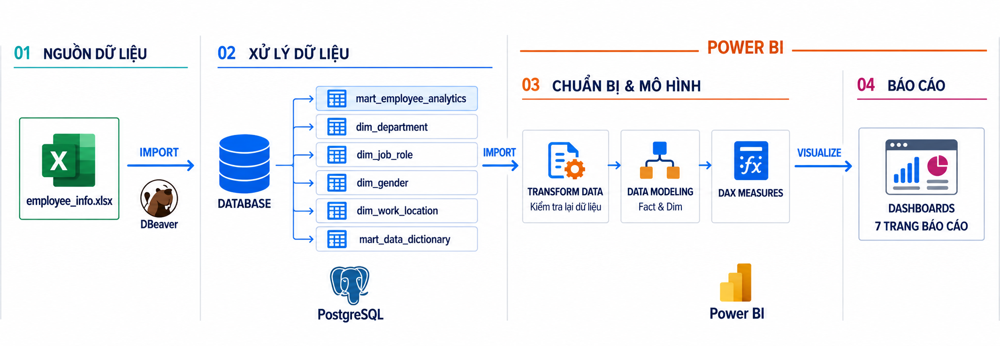

### 4.1. Data Preprocessing

- **Database Ingestion**: Used DBeaver to import `employee_info.xlsx` into the PostgreSQL database.
- **Exploratory Data Analysis & Quality Audit using SQL ([data_quality_check.sql](data_quality_check.sql))**:
  - *Duplicate check*: Verified exactly 10,000 unique records; zero duplicate `employee_id` values.
  - *Missing value check*: Aside from `work_life_balance` having 10,000 missing values (100% Null), all 21 remaining attributes contain complete valid values. Decided to exclude `work_life_balance` from the entire analysis pipeline.
  - *Valid range & logic checks*: Verified age ranges between 18 and 65; tenure spans 0 to 10 years; salary values are strictly positive; performance rating spans 1 to 5; satisfaction levels range from 0 to 1; and manager feedback scores range from 1 to 10.

### 4.2. Data Modeling

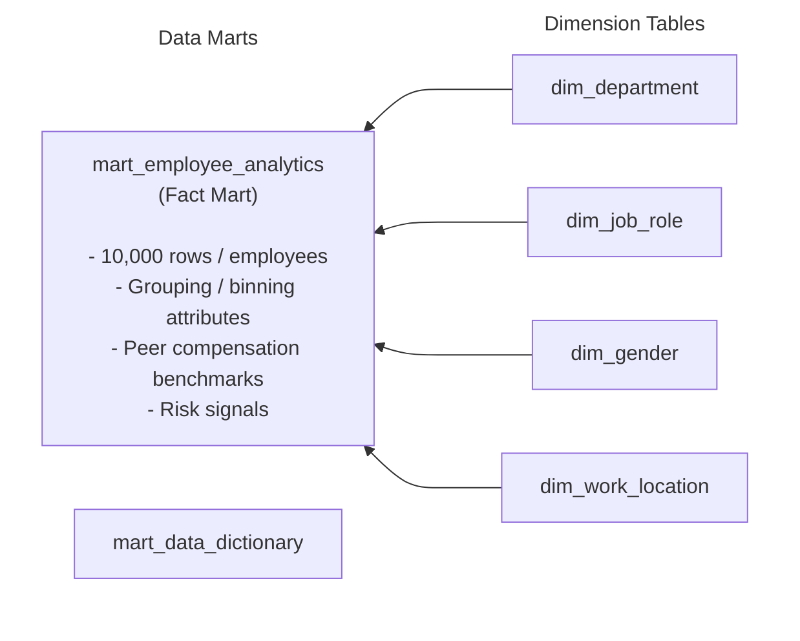
Built dimension and fact tables using SQL ([reporting_marts.sql](reporting_marts.sql)):

1. **Building Dimension Tables**:
   - `dim_department`: Department dimension (`IT`, `Sales`, `Marketing`, `HR`).

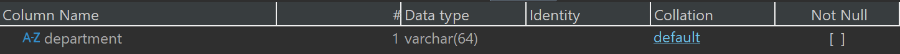

   - `dim_job_role`: Job role dimension (`Analyst`, `Developer`, `Manager`, `Sales`).

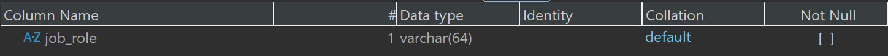

   - `dim_gender`: Gender dimension (`Male`, `Female`, `Other`).

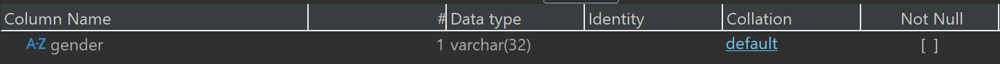

   - `dim_work_location`: Work arrangement dimension (`Remote`, `Hybrid`, `On-site`).

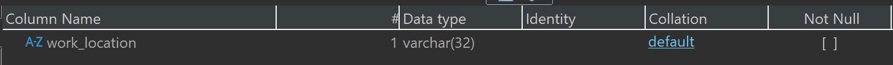

2. **Building Fact Mart (`mart_employee_analytics`)**:

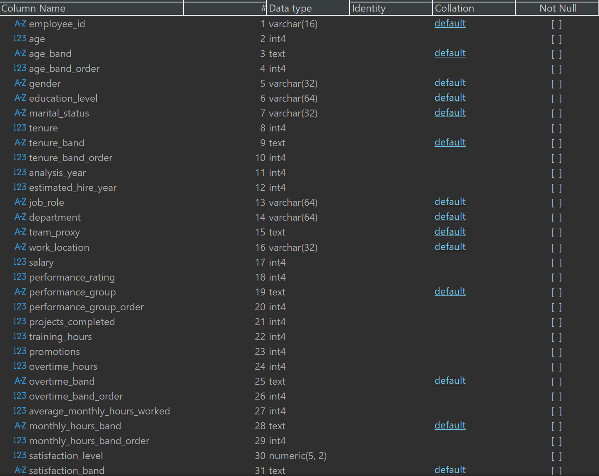
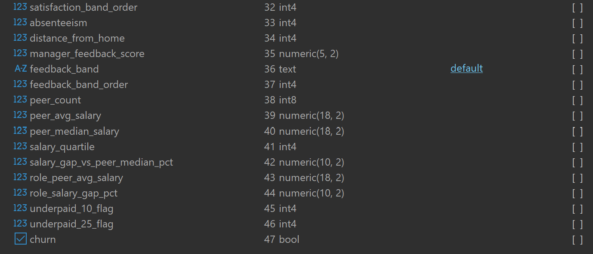

Key derived attributes:

- `tenure_band`: Tenure brackets (`Under 1 year`, `1 to under 3 years`, `3 to 5 years`, `Over 5 years`).
- `age_band`: Age brackets with uniform intervals.
- `overtime_band`: Overtime hours brackets (`0 hours`, `1-10 hours`, `11-20 hours`, `21+ hours`).
- `monthly_hours_band`: Monthly working hours brackets (`150-179`, `180-209`, `210-239`, `240-269`, `270+`).
- `performance_group`: Performance rating groups (`Low (1-2)`, `Medium (3)`, `High (4-5)`).
- `satisfaction_band` & `feedback_band`: Satisfaction and manager feedback tiers categorized into Low, Medium, High.
- `peer_median_salary`: Median salary of peer group (matching `job_role` and `tenure_band`).
- `salary_gap_vs_peer_median_pct`: Percentage salary variance compared to peer median: `(salary - peer_median_salary) / peer_median_salary`.
- `role_peer_avg_salary`: Average salary of peers in the same job role (excluding the employee themselves).
- `role_salary_gap_pct`: Percentage variance relative to role peer average: `(salary - role_peer_avg_salary) / role_peer_avg_salary`.
- `underpaid_10_flag` & `underpaid_25_flag`: Flags identifying employees compensated below benchmark by 10% and 25% or more.

3. **Data Dictionary (`mart_data_dictionary`)**:
   Stores metadata, column names, data types, business definitions, and analytical roles, directly powering the Data Dictionary lookup page in Power BI.

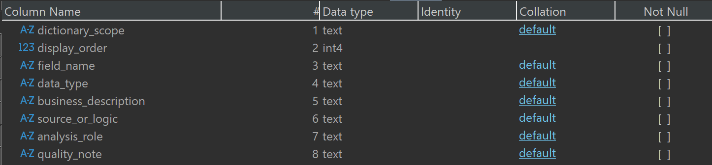

---

## 5. Power BI Visualization & Empirical Findings

### 5.1. Executive Overview

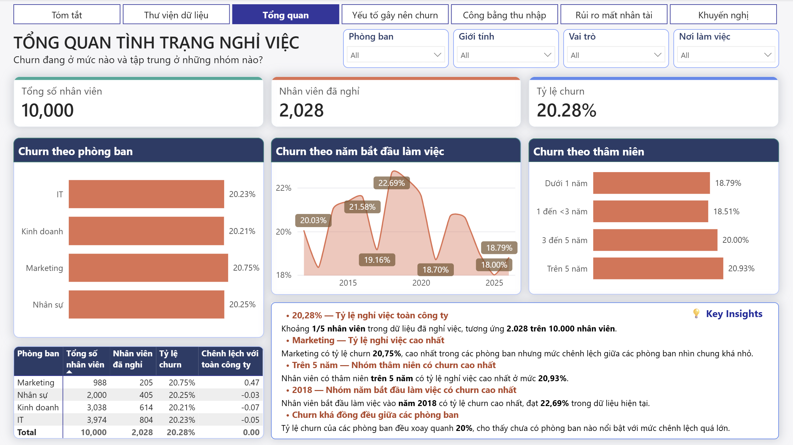

The dashboard captures a total company workforce of **10,000 employees**, with **2,028 departed employees**, corresponding to a company-wide churn rate of **20.28%**.

Key findings:

- **Department churn rates vary within a very tight band**, from **20.21% to 20.75%**. Marketing records the highest rate (20.75%), followed by HR (20.25%), IT (20.23%), and Sales (20.21%).
- **Distribution by hire cohort**: Employees with an estimated hire year of 2018 recorded the highest churn rate at **22.69%**, while the 2025 cohort was lowest at **18.00%**. This indicator is derived from tenure and the 2026 analysis baseline, not actual hiring dates.
- **Distribution by tenure**: Employees with over 5 years of tenure recorded a churn rate of **20.93%**, higher than those with 1 to under 3 years (**18.51%**).
- **Overall assessment**: Employee turnover is not isolated to any single department or tenure bracket, indicating workforce retention must be addressed company-wide.

**Conclusion**: The relatively uniform churn rates across departments and tenure cohorts demonstrate that turnover is an organization-wide phenomenon rather than an isolated departmental issue. Leadership should prioritize synchronized retention initiatives while enhancing workplace experience and career progression opportunities to curb turnover across the organization.

---

### 5.2. Churn Drivers Analysis

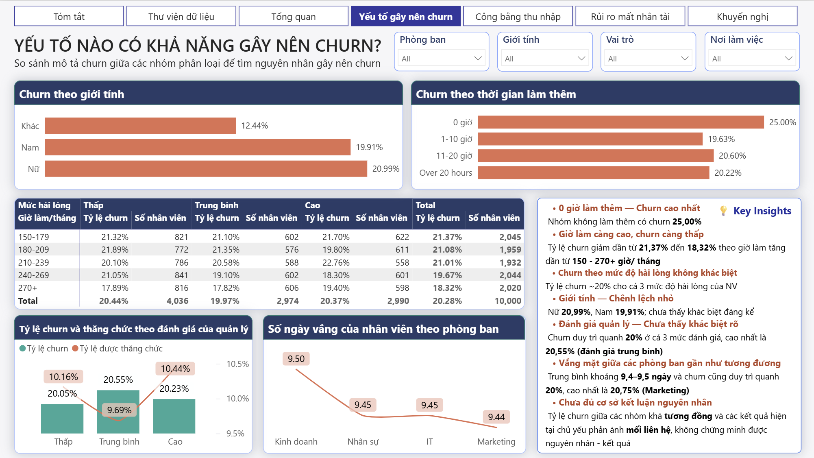

- **Gender**: Females recorded a churn rate of **20.99%**, males **19.91%**, and the other gender group **12.44%**.
- **Overtime Hours**: Employees with zero overtime hours recorded a churn rate of **25.00%**, higher than those working over 20 overtime hours (**20.22%**).
- **Working Hours & Satisfaction**: As average monthly working hours increase from 150–179 hours to 270+ hours, descriptive churn slightly decreases from **21.37% to 18.32%**.
- **Manager Feedback & Promotion**: Churn rates across all three manager feedback groups (Low, Medium, High) hover around 20%; the proportion of employees promoted also remains consistent between **9.69% and 10.44%**.
- **Absenteeism**: Average absent days across departments are virtually identical, ranging within a narrow band of **9.44 to 9.50 days**.

**Conclusion**: Metrics indicate that turnover exhibits minimal variation across working hours, manager feedback, promotion opportunities, and absenteeism. Notably, females and employees with no recorded overtime experienced higher churn rates than comparison groups; therefore, management should tailor retention policies to distinct employee segments while improving the overall employee experience across the firm.

---

### 5.3. Compensation Fairness

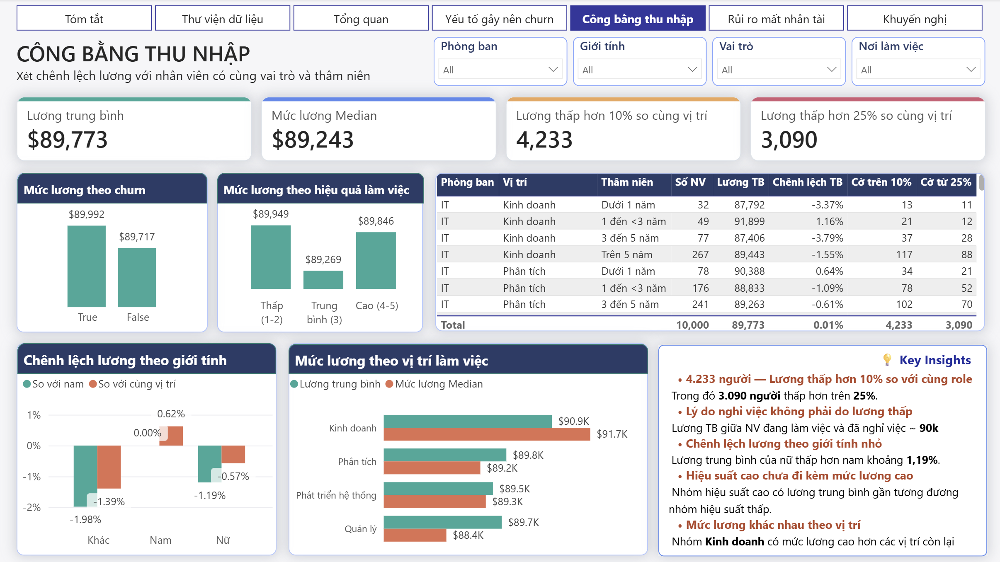

- **Salary Distribution**: Company-wide average salary is **$89,773**, and median salary is **$89,243**. The average salary of active employees (**$89,761**) is nearly identical to departed employees (**$89,821**), demonstrating that lower salary is not a direct explanatory factor for turnover.
- **Peer Disparities**:
  - **4,233 employees** receive compensation lower than their peer group average by 10% or more.
  - Notably, **3,090 employees** receive compensation below the peer benchmark by 25% or more.
- **Salary vs. Performance**: Average salary does not scale monotonically with performance ratings: the low-performance group has the highest average salary ($89,949), the medium group has the lowest ($89,269), and high performers average $89,846.
- **Gender Pay Gap**: Females' unadjusted average salary is approximately **1.19%** lower than males'. After adjusting and controlling for job role and tenure cohort, the gap narrows to **-0.55%** (other gender group disparity is **-1.40%**).
- **Department Pay Disparities**: Sales records the **highest** average and median salary, surpassing **$90k**, while other departments hover around **$89k**, indicating departmental compensation differences are largely marginal.

**Conclusion**: Baseline salaries between active and departed employees are nearly identical, and salary differences across departments and genders are relatively small once controlling for role and tenure. However, the substantial count of employees compensated significantly below peers and the lack of differentiation between pay and performance highlight the necessity for internal equity reviews and better alignment between compensation and employee contributions.

---

### 5.4. Key Talent Loss Risk

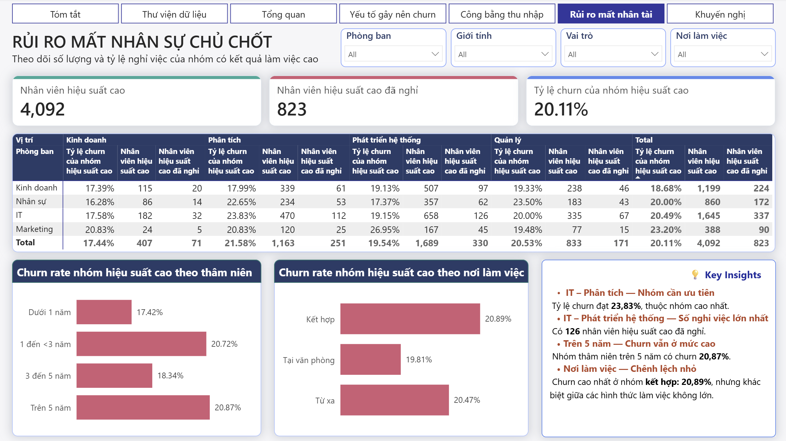

- Metric `performance_rating >= 4` is used to identify high-performing employees.
- The dashboard captures **4,092 high-performing employees**, with **823 having departed**, corresponding to a churn rate of **20.11%** (closely matching company-wide baseline).

Breakdown:

- By Department:
  * Marketing high performers recorded the highest departmental churn rate at **23.20%**, but this cohort is relatively small at 388 employees (90 departed), far lower in volume than IT (337 of 1,645 departed).
- By Job Role:
  * Analysts recorded the highest churn rate **(21.58%)**, representing **251 of 1,163** departed employees. This is notable when compared to Developers, who had the highest raw count of departed personnel **(330 employees)**.
- By Department & Role Combination:
  * IT Analysts recorded a churn rate of **23.83%** (112 out of 470 high performers left). This represents the highest talent attrition rate and should be investigated by leadership as a top priority.
  * IT Developers recorded **126 departed high performers** (out of 658 total). This represents the single largest departure count across all department-role combinations.

- In volume terms, the IT department suffered the largest overall talent loss across the company, totaling **337 high performers** out of 1,645 (accounting for over 40% of all departed high performers).
- Regarding tenure, high performers with more than 5 years of tenure recorded a churn rate of **20.87%**.
- Regarding work arrangement, turnover differences between work models (Remote, Hybrid, On-site) are minimal, ranging from **19.81% to 20.89%**.

**Conclusion**: Although the churn rate among high performers (20.11%) aligns with the company average, talent loss is critically concentrated within the **IT department**. Specifically, **IT Analysts** exhibit the highest departure rate (23.83%), while **IT Developers** recorded the highest departure count (126 people). The company should prioritize retaining key IT personnel, especially within these two groups, through competitive compensation, structured career progression, and timely recognition.

---

## 6. HR Strategic Recommendations

**1. Enhancing Workplace Experience & Retention Policies**

- Build a transparent, equitable work environment that fosters skill development and acknowledges employee contributions.
- Pay attention to distinct experience variations across employee cohorts, especially females and employees without recorded overtime.
- Maintain organization-wide retention policies while directing resources toward segments exhibiting both high churn rates and substantial departure volumes.

**2. Strengthening Compensation Equity & Pay Transparency**

- Audit employee profiles compensated significantly below peer benchmarks, particularly the 3,090 employees with salary gaps of 25% or greater.
- Establish clear salary bands structured by role, tenure, competency, and contribution; ensure evaluations and pay adjustments are executed consistently.
- Align performance appraisal outcomes with bonuses and recognition programs to improve transparency and ensure rewards reflect business impact.

**3. Prioritizing Key Talent Retention in IT**

- Review compensation policies, technical career ladders, and promotional avenues tailored for IT Analysts and IT Developers.
- Reinforce merit recognition, create opportunities to participate in high-impact projects, and formulate clear specialization pathways for key technical personnel.
- Implement flexible retention strategies that accommodate specific technical work characteristics and individual employee aspirations.

---

## 7. Personal Project Takeaways

Gained an end-to-end analytical mindset and execution workflow for solving real-world employee data problems:

- Deepened domain knowledge in Human Resource Management, including turnover dynamics, compensation equity, and talent retention, while mastering data-driven approaches to workforce decision-making.
- Leveraged PostgreSQL to audit data quality, resolving issues regarding integrity, completeness, and boundary anomalies. Designed Dimension and Fact/Mart schemas for reporting, constructing derived metrics and peer compensation benchmarking logic.
- Modeled data and established relationships in Power BI, authored DAX measures, and architected multi-page dashboards aligned with distinct analytical objectives. Visualized core KPIs, trends, and risk segments to enable stakeholders to quickly diagnose organizational health and prioritize operational interventions.
